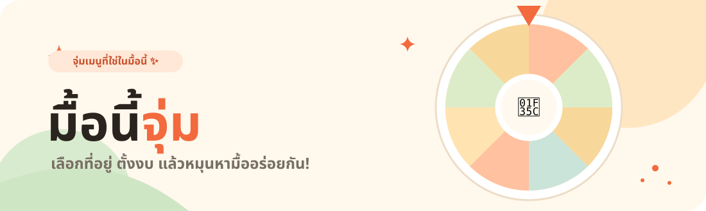

# 🍜 มื้อนี้จุ่ม

<p align="center">
  
</p>

<p align="center">
  <a href="https://ampsoria.github.io/mue-nee-jum/">
    
  </a>
</p>

<p align="center">
  <a href="https://ampsoria.github.io/mue-nee-jum/"><strong>🌐 เปิดเว็บไซต์มื้อนี้จุ่ม</strong></a>
  <br />
  เลือกสถานที่ ตั้งงบ แล้วให้วงล้อช่วยตัดสินใจว่ามื้อนี้จะกินอะไร
</p>

<p align="center">
  <code>🍽️ 126 เมนู</code> &nbsp; <code>🥤 อาหาร + เครื่องดื่ม</code> &nbsp; <code>🎡 หมุนได้ไม่อั้น</code>
</p>

## ✨ มีอะไรให้จุ่มบ้าง?

| | |
| --- | --- |
| 🍚 **เมนูหลากหลาย** | อาหารคาว ของกินเล่น ของหวาน และเครื่องดื่ม รวม 126 เมนู |
| 📍 **เลือกตามสถานที่** | สุ่มจากเมนูที่เหมาะกับห้าง ตลาด โรงเรียน หรือมหาวิทยาลัย |
| 💸 **กำหนดงบได้** | ตั้งราคาสูงสุดต่อเมนู หรือเลือกงบที่ใช้บ่อย |
| 🎡 **หมุนแล้วเห็นภาพ** | วงล้อสุ่มพร้อมชื่อเมนู รูปภาพ และราคาโดยประมาณ |

## 🧡 วิธีเล่น

1. เลือก **อาหาร / เครื่องดื่ม** และสถานที่ที่อยู่ตอนนี้
2. เลือกหมวดหมู่และตั้งงบ หรือปล่อยเป็น **ทุกหมวด** เพื่อสุ่มรวม
3. กด **หมุนวงล้อเลย** แล้วไปหาเมนูที่ได้!

## 🛠️ รันในเครื่อง

เว็บนี้เป็น HTML, CSS และ JavaScript ธรรมดา ไม่ต้องติดตั้งแพ็กเกจ เปิด Terminal ในโฟลเดอร์โปรเจกต์แล้วรัน:

```sh
python3 -m http.server 8000
```

จากนั้นเปิด `http://localhost:8000/` ในเบราว์เซอร์ ข้อมูลเมนูเพิ่มเติมอยู่ที่ `data/thai-menus.json` และรูปภาพอยู่ใน `assets/`

## 📚 ข้อมูลและภาพ

รายการเมนูไทยเพิ่มเติมคัดเลือกจาก [List of Thai dishes](https://en.wikipedia.org/wiki/List_of_Thai_dishes) แล้วจัดหมวดหมู่สำหรับเว็บนี้ ราคาและสถานที่เป็นค่าประมาณ ไม่ใช่สถิติความนิยมจริง ภาพประกอบมาจาก TheMealDB, TheCocktailDB และ Wikimedia Commons ดูรายละเอียดที่[หน้าเครดิตภาพ](https://ampsoria.github.io/mue-nee-jum/credits.html)

<p align="center">Made with 🧡 by <strong>ampsoria</strong></p>
